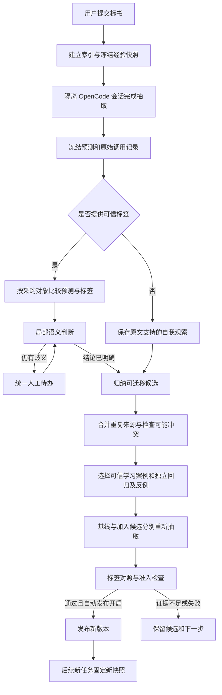

# 抽取与经验演进方案（0.5.0）

这份文档解释当前项目怎样从一篇标书产生经验、怎样验证和生效、以后抽取怎样使用，以及何时需要你参与。页面操作见[工作台说明](memory-dashboard.md)，存储结构见[记忆架构](memory-architecture.md)。

项目有两种运行模式，共用同一套经验库、验证器和版本机制：

| 模式 | 你提供什么 | 系统能获得什么依据 |
|---|---|---|
| 纯条款抽取 `extract` | 带真实 Cxx 的标书 JSON | 原文、自检、修正前后差异，以及有证据的观察 |
| 标签学习 `learn_labels` | 标书 JSON、按当前口径确认的正确结果、案例族 | 隔离盲抽的预测、可信标签和业务差异 |

两种模式都可以产生候选。候选经过可信标签对照和独立回归验证后，才有资格成为已发布经验。不会更新模型参数，也不引入 embedding 或向量数据库。

## 1. 从第一篇开始，经验究竟怎样产生

### 1.1 第一篇只有标书，没有正确结果

1. 建立输入索引，固定当前业务口径和已发布经验快照；空库时快照为空。
2. OpenCode 工作器读取本次交付的完整原文与短经验包，完成抽取和自检。
3. 保存抽取结果、证据、调用来源以及最多三条可迁移观察。
4. 每条观察转成候选经验，保留来源、证据标签、适用条件和排除条件。
5. 尝试使用已经导入的可信标注案例验证；案例不足或不适用时保留候选，并显示等待原因。

例如，本篇原先没有填交换机数量，复核采购清单后找到了对应行。可留下的观察是“技术规格与数量分离时，按明确的采购编号核对清单”，并指出本次证据。不能把“本篇交换机有两台”变成跨标书通用规则。

自检通过、另一个模型同意，均不等于已有正确标签。第一篇的经验可能暂时只是有证据的观察；若库中也没有可用于验证的标注案例，它不会立即影响第二篇。无需为了让页面出现更新而强造经验或发布它。

### 1.2 第一篇同时提供正确标签

1. 归档你提供的输入与标签，记录案例族、用途和业务口径。
2. 启动隔离的抽取会话，只交付原文、业务规则和本任务已发布经验包。
3. 保存并冻结预测结果及其原始事件，再进入标签比较。
4. 程序按采购对象进行闭合比较，局部判断处理范围语义差异。
5. 从已经确定的错误、正确处理方法或新场景中总结候选；没有新发现也可以不产生候选。
6. 自动运行基线和候选两组抽取，并用独立案例检查退化。
7. 满足准入条件且启用了自动发布时，由系统发布；否则保留明确的阻塞原因。

导入标签表示你已经按当前业务口径确认，不再要求逐篇重复执行 `confirm-run`。程序会检查 JSON 结构、标签合法性和文件一致性，但不能仅凭这些检查证明人工标签内容一定正确。

## 2. 整体数据流



原文、模型判断、可信标签、人工局部答复、实验结果属于不同依据，分别留存。系统不会用同一次自我评价同时充当发现问题、正确答案和发布依据。

## 3. 怎样保证先抽取，再看标签

标签学习由阶段控制实现隔离，而不是仅在提示词里写“不要看答案”：

- 每次抽取调用启动新的临时项目和会话，不继续带有标签的旧会话。
- 工作器禁止工具访问，只收到本次原文、明确的业务口径和短经验包。
- 盲抽提示中没有标签正文、标签路径和历史预测答案。
- 预测保存后才交给比较和归纳阶段；基线与候选验证同样使用新的盲抽会话。
- 验证阶段不再产生经验，保留测试不进入自动归纳或晋级调参。

导入时，服务程序会读取标签做结构和定位校验。这不等于把标签交给抽取模型。预测冻结后，比较程序和标签复盘会使用标签；网页也可以供维护者查看它们。

归档包括模型、推理档位、提示、结果、原始事件、会话标识和哈希，实验注册会核对这些依据。它们证明本地流程与文件相互对应，不是抵抗本机管理员的密码学签名，也不保证服务商底层模型始终不变。

## 4. 标签不是逐字答案：怎样比较才符合业务

比较器是 [learning_compare.py](../.opencode/skills/term-extract/scripts/learning_compare.py)。产品分类不计入正确性，条款 ID、标题表述与合法拆分差异也不直接判错。

### 4.1 先建立采购对象

`normal` 自成对象；`separate` 的关联形成无向连通分量。一个对象的有效范围为：

```text
该对象所有设备片段的范围
    ＋ 直接约束该对象的 general 范围
```

不会沿 general 递归连接到其他设备，也不会因为两个设备共享 general 就把它们合并。对齐优先依据设备自身范围，标题只在孤立对象无法对齐时提供待复核线索。

连续一段与多个正确关联的 separate 片段，只要表达同一对象、有效范围和数量相同，可以视为等价。将 general 内联到设备范围的表达也按有效语义比较。

### 4.2 检查完整对象集合

比较不再只检查人工列出的几个锚点，而是检查标签和预测中的完整对象集合。因此可以发现标签中没有的额外采购项，例如单独抽出的机柜；也可以发现标签对象完全没有对应抽取记录。

能够从结构和对应范围确定的错误包括：明确漏对象、额外对象、separate 串联两个不同标签对象、同一 general 扩散到错误对象，以及可确定的数量不符。局部判断不能覆盖这些硬错误。

### 4.3 范围不同，先留语义差异

标签的起止范围可能包含标题、说明和无害冗余，不能把范围内每个字都当作关键参数。

- 预测少了一段：判断是否遗漏影响选型的参数。
- 预测多了一段：判断是否混入其他设备参数，还是允许的说明。
- 多条记录对应同一标签对象：判断是合理表达还是错误拆分。
- 同名对象的定位完全不相交：先复核是否选中了同设备的另一处片段。

比较报告携带有限原文邻域、对象分组和差异标签，并明确提示截断。局部判断返回“无害差异／业务错误／证据不足”和理由；无法可靠处理的项才进入人工待办。

### 4.4 数量与单位

相同数字和单位可归一化表达；`2` 与 `2台` 只有在该对象相关原文中有单位支持时自动等价。`台` 与 `套` 不自动等同，多种计量对象、复杂数量表达或证据不足需进一步判断。可信标签中有明确数量而预测缺失，属于数量错误。

## 5. 从候选到生效：实际运行两组抽取

旧方案需要维护者手写 baseline、candidate 和评测清单。0.5.0 的自动流程由运行器生成模型输出：

| 组别 | 交付材料 |
|---|---|
| 基线 `baseline` | 原文、当前业务口径、本任务固定的已发布经验包 |
| 候选 `candidate` | 相同材料，加上本轮明确指定的候选版本 |

两组使用相同模型、推理档位和业务口径，分别新建会话。输出、提示和原始事件作为可重放工件留存；注册报告时重新检查结果和标签，不能通过上传一个手写 `passed` 声明发布。

自动准入检查包括：

- 候选来源齐全，业务口径和正式经验基线未变化。
- 学习目标达到正确，所有未决语义差异已经处理。
- 没有已检查业务指标回退。
- 至少有独立回归和触及适用／排除边界的反例，来自两个不同的独立案例族。
- 实验工件、候选修订和模型配置绑定一致，存在疑似冲突时先处理。

`fix_improvements` 表示本次实验观察到从错误到正确；`success_cases` 也包含原来就正确、现在保持正确的情况。后者可以支持兼容性，但不能声称提高了准确率。两次随机生成的结果差异也不能单独证明长期因果效果，仍需更多真实独立案例观察。

每项实验启动时单独冻结当时的正式集合，生产预测仍使用任务创建时的快照。前一条候选发布后，后一条可以在新的正式集合上重新建立实验；不会改写原生产预测。实验进行中集合再次变化时，保留结果并要求重新建立该项基线。预算不足、案例不足或反例选择不成立时同样保留阻塞原因，不把两个无关案例都正确当成已经证明候选适用。

## 6. 案例族和用途怎样设置

| split | 用途 | 是否允许归纳经验 |
|---|---|---|
| `development` | 学习、定位错误与验证修复目标 | 允许 |
| `regression` | 验证对独立文档是否退化 | 不用于该运行的经验归纳 |
| `holdout` | 留给独立最终评估 | 不参与自动归纳、晋级和反复试验 |

同一标书的修订、译文、模板近重复或项目变体应使用同一 `family_id`。输入哈希相同的案例不能通过改名同时充当学习和独立回归。系统能检查你声明的家族及相同输入，不能自动识别所有语义近重复；合理划分家族仍是少量人工工作之一。

每个可信案例保存输入、标签及内部索引的私有归档，同时检查原文件和归档哈希。移动、删除或改写这些文件后可能需要重新导入；不要在原路径直接覆盖作为实验依据的文件。

## 7. 经验怎样消费，为什么暂时不需要向量

生产抽取消费已发布经验，学习实验可以显式注入候选。每篇任务固定快照，任务过程中不切换到新发布版本。

当前为本地关键词召回，支持有限的繁简和中英别名归一化。它不是完整翻译或语义检索。交互抽取按具体疑点调用 `term_memory_recall`，默认最多三条、约 6 KiB；高层运行器在本地扫描全部定位片段，提取有限设备别名和问题类型形成检索词，交付最多五条、约 8 KiB 的短包，再让工作器阅读完整原文。

交付包括适用条件、执行规则、排除条件与来源编号，不包含历史标书和标签全文。当前排序使用触发词加权和正文词项重合，规则完整交付，放不下会跳过并记录，不截断单条规则。

交付记录只能证明模型收到了哪条经验，不证明一定采用或带来改善。检索词仍受有限别名表和短查询预算约束，可能漏召回；尚未实现对全部产品候选的多轮语义检索。引入向量之前，可以先利用实际漏召回继续补充别名和触发词。

## 8. 重复、冲突和过期怎样处理

新增候选时检查重复与可能冲突。确定重复以问题类型、适用条件、规则和排除条件的规范文本为依据，合并触发词和来源；来源增加会形成修订，不抹掉旧事实。当前不声称自动识别所有语义重复。

冲突检查结合固定范围提示和相近规则的方向差异。例如，要求抽取机柜／布线，或把纯品牌准入独立抽成 general，会进入疑似冲突复核。关键词命中仅表示风险，不直接判定矛盾，也不自动删除经验。

新增候选会触发检查。网页服务以可写模式运行时，后台每 60 秒检查是否需要维护：候选或业务口径变化时扫描，否则默认七天重扫一次。服务关闭期间不会扫描，`--read-only` 或 `--no-maintenance` 可禁用后台维护。维护不调用模型，不修改规则正文，也不自动发布或撤回。

网页“检查经验冲突”和 `evolution_store.py scan-conflicts` 可强制扫描存量，不需要等待七天。扫描以当前业务口径摘要和规则修订签名去重，已有同一疑点不会反复创建待办。

人工可以确认条件不同、要求修订、不采纳或保留不确定。答复作用于指定经验版本；系统不会把一次局部答复变成全局业务口径。正式业务口径仍通过 `business-rules.md` 明确更新并由 Git 留痕。

## 9. 人工只处理例外，网页和聊天共用记录

默认入口是工作台“待确认事项”。每项问题包含局部原文、差异、可选处理意见和作用范围。你只需选择或补充说明，不必手写经验 JSON 和实验 manifest。

也可以在 OpenCode 对话中明确答复某一待办，由 `term_learning_reply` 保存用户原话和消息引用。它与网页写入同一条记录；agent 不代替用户作答，也不因为用户同意一项局部判断就确认整篇结果。

回答后继续原任务，可复用已经冻结的预测；等待案例的任务在补充独立案例后也可继续。已完成任务若要重新抽取，应新建任务。旧待办答复不可静默覆盖；发现新的问题需追加新事实或新任务。

你仍需要参与：提供可靠标签及合理家族划分、处理模型无法解决的语义和业务冲突、少量抽查自动发布经验。系统不会完全消除人工判断。

## 10. 模型与资源预算

工作台“模型设置”选择本机 OpenCode 已配置的 `provider/model`，沿用其凭据，不在页面输入或保存密钥。普通浏览不会调用模型；创建并启动学习任务会产生实际模型调用。

默认限制为：最多 12 次模型调用、累计模型执行 600 秒、单次 180 秒、单次提示 512 KiB、最多选择 2 个独立验证案例。可以在页面修改。提示字节预算不等于模型上下文窗口，完整原文超限时不会自动截断，应调整预算或模型。

一次完整学习可能包含生产抽取、结构修复、标签复盘、案例选择、两组验证和局部判断；候选越多，需要的调用可能越多。达到预算会停止并保存状态，不承诺每个任务在默认预算内完成。

记录实际调用次数、耗时和服务返回的 token、费用。服务未返回某项数据时显示未记录，不按零费用计算。当前没有以货币金额或 token 总数进行硬限额；不能据此声称已经量化节省成本。

## 11. 实现位置与私有数据

| 文件 | 作用 |
|---|---|
| `learning_runner.py` | 配置、阶段任务、隔离调用、冻结预测、实验与预算 |
| `learning_compare.py` | 对象对齐、完整集合检查、有效范围与局部判断应用 |
| `evolution_store.py` | 可信案例、待办与答复、来源合并、冲突和实验注册 |
| `memory_store.py` / `memory_lexical.py` | 修订、发布、快照和关键词召回 |
| `evolution_dashboard.py` / `web/memory/evolution.js` | 两种模式与人工待办的页面入口 |
| `term_learning.ts` / `evolution_cli.py` | OpenCode 高层工具与文件参数桥接 |

默认存储仍是 `.term-memory/memory.sqlite3`。可信案例位于私有 `evolution-artifacts/`，高层作业工件位于私有 `.workflow/jobs/`。它们与原有 `learning-artifacts/` 和每篇 `runs/` 一同被 Git 忽略，不随代码推送。

0.4.0 的复盘、反馈、人工确认、离线断言与手动发布入口继续可用，用于旧记录和特殊维护；它们不自动变成可信标签学习任务。详情见[旧维护入口](../.opencode/skills/term-extract/references/experience.md)。

当前实现验证的是流程、隔离、工件一致性与合成场景的准入逻辑。真实标书上的质量收益、长期稳定性及成本优势，仍需要使用你们的独立标注案例实测。
