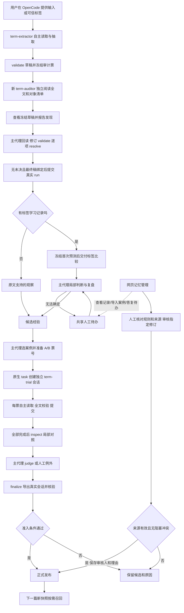

# 抽取与经验演进方案（0.6.2）

**唯一执行入口是 OpenCode 的 `term-extractor` 主代理。** 它加载中文 Skill，自主决定何时读原文、查经验、检查边界、安排提交前独立核验、处理发现、提交结果、比较标签和组织经验验证。Python 提供可校验的原子工具，负责文件、定位、比较、存储和准入；不选择模型、不发送模型请求、不替代理调度整个流程。网页管理记忆与人工结果校验。

这次将 0.5.0 的两条执行路径统一：原来的 Python 高层运行器已停用，旧任务仍能只读查阅。两种模式共用同一代理和抽取工具，不再由网页启动另一套抽取。

| 模式 | 用户提供 | 代理产生什么 |
|---|---|---|
| 纯条款抽取 | 带真实 Cxx 的输入 JSON | 七字段结果、证据、原文支持的观察，或没有新经验的原因 |
| 标签学习 | 输入、同套 Cxx 且按当前口径确认的正确结果、案例族 | 先完成的预测、冻结后的标签比较、可迁移候选及验证记录 |

不更新模型参数，暂不引入向量模型。经验经过独立评测准入，或由维护者人工审核指定版本后发布，才进入正式召回。页面操作见[记忆工作台](memory-dashboard.md)，存储细节见[记忆架构](memory-architecture.md)。

## 1. 从一篇标书到经验

### 只有输入时

主代理先准备定位索引与已发布经验快照，自主读取完整原文。它可以按具体疑点查经验、搜索数量清单、复核对象边界；草稿经过程序校验后，再由新 `term-auditor` 子会话独立阅读全文、固定对象清单，之后才查看冻结草稿。主代理回读原文、处理全部发现并关闭到最终稿，再提交。

提交同时保存简体中文复盘，最多三条观察；每条说明问题、证据标签、适用条件、做法和排除条件。没有可迁移发现时明确说明原因，不强造经验。

例如，技术规格没有数量，但另一处采购清单有明确设备编号与数量。可记录“按明确采购编号关联清单数量”，而非把“本篇交换机有两台”写成普遍规则。

这些是有原文依据的观察，**不是人工正确标签**。自检、另一个模型同意或 JSON 通过都不能证明业务正确。观察可以成为候选；没有可信验证案例时，agent 保留等待，不自行发布。维护者也可单独审核规则并人工发布，无需把整篇输出确认为正确标签。

### 同时提供正确标签时

主代理使用标签学习原子工具：

1. `prepare` 建立原文索引与正式经验快照；`term_learning_begin` 校验并私有归档标签，此时不返回标签正文或路径。
2. 同一主代理使用正常 `read / checkpoint / search / recall / validate` 自主抽取，完成提交前独立核验与逐项处置后 `commit`。审计者不看可信标签，主代理此时也仍不看标签。提交工具写入真实 OpenCode 会话、消息和代理上下文。
3. `term_learning_compare` 检查是本会话提交的完整抽取，冻结首次预测，再比较并分页交付标签与差异。
4. 主代理针对待定差异查局部原文并判断；无法确定的项进入人工待办。
5. `term_learning_reflect` 保存错误或正确处理方法中的可迁移经验，合并确定重复的来源，检查可能冲突。
6. 主代理自行选可信案例，创建独立 A/B 盲抽试验，核验并完成实验。只有自动准入门槛通过，agent 才能发布；人工可另行审核指定规则版本并发布。

提供标签已代表用户按当前口径确认，不再逐篇要求旧版 `confirm-run`。程序检查标签结构与文件一致性，无法凭此证明人工标签没有语义错误。

## 2. 谁负责哪一步

上图是代理应遵守的工作协议，不是 Python 预先调度的模型调用链。代理负责理解、选择和工具调用；程序负责拒绝越序、身份不匹配、材料变化或证据不够的请求。

### 本篇内容核验与经验验证的分工

| 环节 | 子代理看什么 | 产物与边界 |
|---|---|---|
| 提交前 `term-auditor` | 冻结原文和规范；先独立清单，之后才看主草稿 | 有证据的发现，不改结果、不学习、没有人工 gold |
| 经验 A/B 的 `term-trial` | 单票原文、静态规范与冻结经验包；不看标签 | 冻结七字段结果；保持原协议，不额外增加内容审计 |
| 提交后网页 `term_review_*` | 用户显式整篇确认的不可变修订 | 主代理对照总结候选；不能以审计完成代替人工确认 |

主代理以 `term_audit_prepare(index_path,result_path,evidence_path)` 保存草稿冻结副本，再使用新原生 task，prompt 严格只有 `audit_id=票号`。审计者只有 open/read/search/inventory/draft/finish 六个专用工具，先读完整原文、形成独立对象清单，才能分页看冻结的七字段草稿。它不接收主 sidecar notes、父会话完整推理、标签、历史答案或预期错误；读取回执独立，不能与主会话混用。主工作稿在报告期间可以变化，子会话仍只核对本票原稿。

新票固定 `protocol_version=2`：按可选型设备或有明确依据的整体系统清点，避免用章节总名概括 AC/AP；真正整体采购的超融合系统不强拆。`finish` 还须逐对象保存 covered/missing/uncertain 对应与依据，漏对象或不确定项关联真实发现。报告包含独立清单和对应关系，`inspect(section="coverage")` 可分页查看；覆盖统计针对冻结草稿，不是主代理修订后成稿的复核成绩。旧票保持原协议。

中断后主代理用 `term_audit_status` 只读阶段、原子会话与原文/草稿首个覆盖缺口，优先以返回的 `continue_task_id` 恢复同票。报告已完成则继续 inspect；无法恢复才显式 `term_audit_abandon` 记录原因，再为当前验证稿 prepare 新票、新子会话重新核验。废弃票保留工件但不能再使用，旧覆盖不转移；已 cleared 的票不能废弃。状态查询不交付答案，也不替代报告读取或人工校验。

主代理用 `term_audit_inspect` 读完报告，在报告完成后用自己的 `term_document_read` 回读发现的证据，修订并 validate，再用 `term_audit_resolve` 一次提交全部 fixed/dismissed/unresolved、理由和标签。标记为已修正的发现要落实结果改稿，不采纳要有原文依据，任何未决都保留草稿并阻断提交；无真实问题可接受空报告。首次关闭允许为真实 fixed 发现接受修订稿，记录 `final_draft_independently_reviewed=false`；无发现或全 dismissed 时若结果变化，必须新票。已经 cleared 后，结果或 sidecar 任一哈希再变必须新票、新子会话，不能旧 resolve 重绑。finish 后的主代理修正不能称为再次独立复核；不做无上限往返，也不因未知问题自动省略审计。

正常真实 OpenCode 主代理 commit 强制检查此门槛；没有 execution_context 的历史 Python CLI 保持兼容，不借此绕过主流程。独立核验增加全文读取与模型成本，不能当作正确标签、漏抽保证或节省 token 的证据。七字段、固定业务口径和用户网页校验保持不变。详细字段与阶段限制见[独立内容核验](../.opencode/skills/term-extract/references/independent-audit.md)。

## 3. 先抽取，再看标签

标签学习通过工具边界限制揭示时机：

- `begin` 归档标签但不将内容交付模型；学习摘要也不暴露标签位置。
- 当前会话必须先完成原文读取与正式提交；`compare` 才冻结预测、交付对照。看过标签后的修改不能替换首次预测。
- 学习绑定创建它的 OpenCode 会话。已揭示一篇标签的会话不能继续开展另一篇盲抽学习，应新开会话。
- 主代理不能把标签、已有答案或对照结论附加到盲抽子任务；子任务提示只能为 `trial_id=对应票号`。
- 验证子代理只拥有试验限定工具，不拥有学习、标签读取、经验修改或任意文件读取工具。

服务端在导入时读取标签作校验，不等于把标签交给模型。网页可信案例详情可供人查看，因而网页 API 不是盲抽代理的读取工具。权限限制和 transcript 核验是本机流程约束，不是抵抗本机管理员的安全隔离，也不能清除模型已有外部知识。

## 4. 标签比较按业务判断

`learning_compare.py` 比较完整采购对象集合、有效参数范围、数量和关联；产品分类不计入正确性，标题或 ID 不同不直接判错。

`normal` 自成对象，正确关联的 `separate` 片段形成同一对象；直接约束它的 `general` 扩展有效要求。共享一个 general 不会把不同设备合并，连续表格的两行也不能仅因位置分开就抽成 separate。

比较首先检查是否有目标对象漏抽、是否多了不该抽的设备、是否将两个对象错误关联。数量只做有原文依据的归一化：`2` 与 `2台` 需原文单位支持；`台` 和 `套` 不自动等同。

范围有差异时先保留待判断项：少一段可能遗漏关键参数，也可能只是标签包含页脚；多一段可能混入其他设备选型参数，也可能是允许的少量说明。主代理读取有限邻域，必要时查更多原文，提交“无害／业务错误／证据不足”和理由。程序不允许局部判断覆盖已经确定的硬错误。

对照支持分页和字节预算，响应注明有无更多内容和截断。代理不能把未读完的差异当成“没有问题”。产品分类仅参考、无害冗余可接受等口径保持不变。

## 5. 经验验证仍由 OpenCode 自主完成

主代理决定验证哪条候选、使用哪些案例及其角色，并给出反例触及的适用或排除边界。Python `prepare` 只冻结这些明确选择，不自动选案例、不自动发起 task。

| 试验组 | 新子会话收到 |
|---|---|
| baseline | 本案例原文、固定业务口径、明确选定的正式经验包 |
| candidate | 相同材料，加本次指定候选修订 |

主代理用 OpenCode 原生 `task` 为每张票创建全新 `term-trial` 子会话。每个会话只处理一张票，使用 `term_trial_open / read / search / checkpoint / validate / commit` 自主抽取，必须完整读取并正式提交。它不归纳新经验，避免回归案例成为新的调参来源。

所有票完成后，主代理调用 `term_learning_trial_inspect` 分页看局部对照，`judge` 仅处理 review 项，未知项进入共享待办。`finalize` 再通过本机 `opencode export` 读取真实会话记录，核对：

- 子会话的父会话与票号一致，唯一用户提示未夹带标签或答案。
- 会话只使用允许的试验工具，真实 commit 已完成，工件和读取记录一致。
- 全轮 A/B 及局部 judge 使用同一实际 provider/model 和 variant。
- 当前业务口径、正式集合、候选修订、输入与标签工件均未漂移。

无法导出会话、未完成或来源不一致时不能晋级。它读取已发生的执行记录，不发起抽取。实验注册会重新计算业务比较，不能上传一个手写 `passed` 代替真实实验。

准入至少需要学习目标、独立回归和触及适用／排除边界的独立反例三个案例角色，回归与反例来自两个不同且与归纳来源独立的案例族。候选需达到正确、无已检查指标退化、无未决阻塞冲突。`term_learning_trial_finalize` 只核验并登记实验评测；评测通过后，主代理再调用 `term_learning_trial_publish`，由工具读取本计划绑定的最新 passed 报告发布，无需人为逐条批准。未通过则保留候选和原因。

基线、候选各抽一次，三个案例至少需要六个子会话，再加主代理的比较与判断。这六个子会话不含最初主代理的盲抽。新架构没有旧运行器那套网页调用预算，也不为每个产品单独创建代理。需要控制验证规模时，应明确告诉主代理可用案例数与调用额度，并按 OpenCode 实际记录评估成本，不能声称已经量化节省。

`fix_improvements` 记录本实验从错到对；`success_cases` 也可能只是原本正确且保持正确，不能据此声称提升准确率。单轮生成结果不能证明长期因果效果。

### 人工审核发布是另一条路径

在网页“经验库”打开候选或最新修订，核对规则、触发词、适用/排除条件和来源证据。需要修改时先保存新 revision，再选择“人工审核发布此版本”，填写审核人和审核理由。无需先完成独立试验或把整篇来源输出确认正确；审核只对当前这一条规则、这一版内容负责。

这条路径保存独立 `approval_id`、审核人、理由、精确 revision、内容摘要与时间，`publication.basis=human_review`，`evaluation_id=null`。没有评测记录时显示“未评测”；存在评测但未用作本次准入时显示“未采用评测准入”。两者都不会写入或伪装成评测通过。源材料缺失或哈希变化、未解决的阻塞冲突仍不能通过；来源未确认、反馈不含完整修正稿等会提示审核人，但不要求先验收整篇。

人工发布不会补写 `confirm-run`、`confirm-feedback` 或可信案例标签，也不让 agent 获取人工发布工具。普通对话中的局部回复不自动发布；维护者在网页或人工 CLI 明确完成审核。发布可撤回，后续仍可安排评测；无论哪条发布路径，都只影响之后新准备的任务快照。

## 6. 案例族与用途

| split | 用途 |
|---|---|
| development | 归纳经验、定位错误与验证修复目标 |
| regression | 独立回归，不能用于本轮归纳调参 |
| holdout | 独立最终评估，不参与自动归纳、反复试验或晋级 |

同一标书的修订、译文、模板近重复或项目变体使用同一 `family_id`。输入哈希相同不能换名字充当独立案例；程序能检查声明与相同原文，不能识别所有语义近重复。

可信案例归档输入、标签和内部索引，并绑定原文件及归档摘要。移动、删除或改写依据后可能需要重新导入；不要直接覆盖已用作实验依据的原路径。

## 7. 经验怎样被下一篇消费

每篇抽取固定已发布经验快照。主代理按对象、数量、边界或关联疑点调用 `term_memory_recall`，关键词、有限繁简与中英别名在本地匹配；默认交付最多三条、约 6 KiB，工具允许有界调整。

规则包包含适用条件、做法、排除条件和版本来源，不包含整篇历史标书或标签。规则完整交付，预算放不下会跳过并说明，不能把规则截断到失去条件。交付记录仅证明收到哪些版本，不证明模型一定采用。

候选不进入正式召回，只能明确注入试验。每项试验另冻结启动时正式集合；集合在实验中变化时需重建该项基线，不改原始生产预测。新发布或撤回只影响后续新准备的快照。

当前没有向量模型或全文向量索引。先用实际漏召回补充触发词、别名和适用条件；关键词检索仍可能漏掉语义相似场景。

## 8. 重复、冲突与人工例外

确定重复按问题类型、适用条件、规则与排除条件的规范文本合并来源；来源增加形成新修订，历史保留。相似文本不自动等于重复，关键词方向相反也只代表疑似冲突。

新增候选会检查固定业务口径和可能冲突。可写网页服务存活时，后台每 60 秒检查是否需要维护：候选或口径变化时重扫，否则默认七天重扫；停止服务期间不执行。`--read-only` 或 `--no-maintenance` 禁用维护；网页按钮及 CLI 可强制扫描。维护不调用模型，不自动改写、发布或撤回经验。

人提供可靠标签及案例族，处理模型无法确定的局部差异与经验冲突，也可直接审核并发布指定经验修订，再抽查效果。网页和 OpenCode 对话共用待办；对话工具保存用户真实原话与消息引用，代理不能假装人工答复或发布审核。

局部答复不等于整篇验收、全部候选批准或全局业务口径变更。回答后回到原 OpenCode 会话继续，不重做已冻结预测。业务口径仍通过 `business-rules.md` 显式修改并用 Git 留痕。

## 9. 实现与兼容

| 文件 | 职责 |
|---|---|
| `SKILL.md`、主代理配置 | 自主执行协议、工具权限和阶段责任 |
| `term_document.ts` / `term_result.ts` | 原文、回执、校验、正式提交与真实执行上下文 |
| `term_learning.ts` / `agent_learning.py` | 标签归档、首次冻结、对照分页、局部判断和复盘 |
| `agent_trials.py` 与试验工具 | 明确票号、限定子会话、实际导出核验、配对实验注册 |
| `learning_compare.py` | 完整对象、有效范围、数量与关联差异 |
| `evolution_store.py` | 可信案例、待办、候选来源、冲突与准入 |
| `memory_store.py` / `memory_lexical.py` | 经验版本、发布、快照与关键词召回 |
| `memory_ui.py` / 工作台 | 查看记录、导入案例、人工答复与经验维护 |
| `learning_runner.py` | 0.5.0 历史记录只读兼容；旧执行入口明确报错 |

私有数据保存在 `.term-memory/` 和 `runs/`，均被 Git 忽略。旧 Python 作业和设置历史不删除、不再用于新抽取。旧来源确认、离线断言、评测后手动发布与撤回保留原门槛；人工直发另存规则审核，不冒充来源确认或评测准入。

软件检查验证阶段门槛、隔离、工件一致性与合成场景；真实标书上的质量、长期稳定性及成本收益，仍需你们的独立标注集验证。
