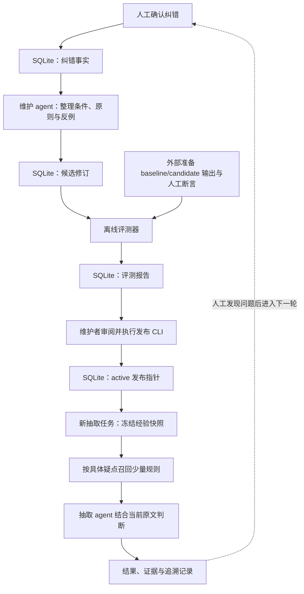

# 经验记忆技术方案与完整数据流

本文对应当前 **0.2.0** 实现，面向需要理解、维护或继续开发本项目的人。阅读代码和操作参数可分别参考文末索引及 [经验维护操作说明](../.opencode/skills/term-extract/references/experience.md)。

先明确当前记忆的形式：**把人工纠错提炼成短小、带适用边界的规则，经过评测与发布后，按需放入后续抽取任务的模型上下文。** 模型参数不会因此更新。新会话能使用旧经验，是因为工具重新读取了持久化规则，而不是模型自动记住了上次聊天。

本文的 JSON 片段均为结构示意，编号、摘要及文字不是真实案例，也不表示已经发布了经验。源码仓库不附带案例、记忆数据库或运行结果。

建议先读第 1–2 节理解“记忆是什么”，再沿第 5 节看一次抽取、沿第 6 节看一次演进；第 7 节解释回归检查能证明什么，第 11 节列出尚未实现的部分。

## 1. 先分清四类内容

| 内容 | 举例说明 | 保存位置 | 日常抽取如何使用 |
|---|---|---|---|
| 固定业务规则 | normal/general/separate 的定义、数量取证原则 | `business-rules.md` 等技能文件 | 开始任务时读取 |
| 人工纠错事实 | 哪份输入曾抽错、错误与正确输出、修改原因、确认人 | 私有 SQLite 的 `corrections` | 不会整批交给抽取 agent |
| 可复用经验 | 在什么前提下应增加哪一步判断，哪些情况不能套用 | SQLite 的 `revisions`，由 `active` 选择发布版本 | 只从本任务快照按需召回 |
| 单次任务记录 | 原文索引、候选草稿、读过哪些内容、最终结果 | `runs/任务目录/` | 用于当前任务与追溯，不自动变成全局经验 |

其中，**纠错事实提供依据，可复用经验改变后续判断方式**。保存了一份正确输出，不等于系统已经学到了可迁移的经验；候选经验写入数据库，也不等于已经生效。

例如，某次人工纠错发现“采购量被误读成端口数”，可复用的内容应是数量取证前提与核验动作。具体文档里的设备数量、设备名称和 C 标签仍属于该文档的事实，不能直接搬到另一份标书。

## 2. 一条经验在数据库里长什么样

一条修订由 `memory_id + revision` 唯一确定，规则正文为结构化 JSON：

```json
{
  "memory_id": "mem_example",
  "revision": 1,
  "content_sha256": "规则正文的 SHA-256 摘要",
  "payload": {
    "title": "按采购对象核对独立清单中的数量",
    "issue_type": "quantity",
    "triggers": ["采购数量", "purchase quantity", "item number"],
    "applies_when": "正文与清单能够通过明确采购编号确认是同一计量对象。",
    "rule": "核对采购编号、单位和适用范围，再将清单数量作为证据；不要把端口数或容量作为采购量。",
    "exclusions": "编号不能对应、清单是总计而正文是单站配置，或者两处计量对象不同的情况。",
    "correction_ids": ["corr_example"]
  }
}
```

这段内容表达的是一个**有条件的核验建议**。程序会检查字段、长度和引用是否合法，但不会自动理解这些自然语言条件是否正确。

从模型视角看，经验就是工具消息中的规则文本，会占用上下文。工程机制负责持久化、选择、版本控制、发布与撤回；自然语言规则的理解和应用仍由主 agent 完成。

几个字段的作用不同：

- `triggers` 用于便宜地找到可能相关的经验；不是自动触发后直接执行的条件表达式。
- `applies_when`、`rule`、`exclusions` 共同交给主 agent，由它结合当前原文判断是否采用。
- `correction_ids` 指向依据，方便维护者复核；召回时不会连带展开纠错的输入与错误/正确输出。
- `issue_type` 是经验检索与维护分类，取值为 `missing_product`、`boundary`、`quantity`、`association`；不是最终结果里的产品分类。

单条 payload 的规范 JSON 最多 4096 字节，避免规则越写越长，或者为了预算而只交付处理原则、丢掉适用边界。

### 2.1 编号、修订和发布集合

| 标识 | 含义 |
|---|---|
| `correction_id` | 一次已导入的人工纠错事实 |
| `memory_id` | 同一条经验的稳定编号 |
| `revision` | 这条经验的某个不可变修订，从 1 递增 |
| `content_sha256` | 该修订 payload 的内容摘要 |
| `evaluation_id` | 一份不可变离线评测报告 |
| `release_sha256` | 当前发布集合的摘要：按编号排序后的 `[memory_id, revision, content_sha256]` 列表取哈希 |
| `snapshot_sha256` | 一个任务的经验快照内容摘要，包含任务索引绑定信息 |

`release_sha256` 不是递增版本号。同一发布集合可以得到相同摘要；每篇任务的快照还包含建立时间与索引摘要，身份与发布集合不同。

## 3. 物理存储与数据边界

默认目录如下。标有“私有”的内容均不进入 Git：

```text
项目根目录/
├── README.md
├── docs/memory-architecture.md              # 本文，供人阅读
├── .opencode/
│   ├── agents/
│   │   ├── term-extractor.md                # 日常抽取
│   │   └── term-memory-curator.md           # 经验维护
│   ├── tools/term_memory.ts                 # OpenCode 记忆工具适配
│   └── skills/term-extract/
│       ├── references/                     # 固定业务与维护约定
│       └── scripts/
│           ├── memory_store.py             # 存储、发布、快照、召回
│           └── memory_evaluate.py          # 离线断言评测
├── .term-memory/                            # 私有，Git 忽略
│   └── memory.sqlite3
└── runs/任务目录/                           # 私有，Git 忽略
    ├── index.json                          # 当前标书原文与定位索引
    ├── memory_snapshot.json                # 注册时全部已发布经验
    ├── memory_receipts.jsonl               # 此任务实际交付过的经验标识
    ├── read_receipts.jsonl                 # 原文交付覆盖记录
    ├── draft/
    │   ├── candidates.json
    │   ├── result.json
    │   └── evidence.json
    ├── validation.json
    └── final/
        ├── result.json
        ├── evidence.json
        └── run.json
```

可用 `TERM_EXTRACT_MEMORY_DIR` 把数据库放到项目之外。导入、维护、发布和启动 OpenCode 的进程必须使用相同设置，否则它们会操作不同的库。自定义目录若仍在 Git 工作区内，需要另加忽略规则。

空库可以正常抽取。只读取空库不会创建数据库；首次导入或写入时才创建。SQLite 使用 WAL 模式，运行时也可能出现配套的 `-wal`、`-shm` 文件。

### 3.1 SQLite 的六张表

| 表 | 保存内容 | 更新方式 |
|---|---|---|
| `corrections` | `correction_id`、完整 `record_json`、记录摘要 | 追加，不覆盖 |
| `revisions` | `memory_id`、`revision`、`payload_json`、内容摘要、建立时间 | 新修订追加 |
| `evaluations` | 候选身份、完整 `report_json`、报告摘要 | 评测报告追加 |
| `active` | 每条经验当前发布的修订和发布所用评测编号 | 发布时切换，撤回时删除指针 |
| `used_evaluations` | 已被一次发布使用过的评测编号 | 追加，防止重复使用旧报告 |
| `audit` | 发布/撤回事件、审核人、说明和相关摘要 | 事件追加 |

除 `active` 外，内容表通过 SQLite 触发器限制 UPDATE/DELETE。发布不是把候选文件移动到另一个文件夹，而是在事务中更新 `active`。

### 3.2 纠错记录到底复制了什么

`corrections.record_json` **不只保存文件路径**，当前实现还保存了可解析的错误输出和正确输出：

| 数据 | 当前保存方式 |
|---|---|
| 原始标书 JSON | 绝对路径与原文件 SHA-256；不将原文复制到纠错记录 |
| 错误输出 | 路径、摘要，以及解析后的 `before_json`；解析失败时该字段为 null |
| 人工正确输出 | 路径、摘要，以及解析后的 `after_json` |
| 修改原因、确认人、文档家族 | 保存在纠错记录中 |

导入器要求正确输出是 JSON 数组，这不等于程序证明了标签的业务正确性。错误/正确输出解析有大小限制；原始文件仍应保留，发布时会重新检查三个来源文件的摘要。

`show-correction` 和 `term_memory_correction` 返回元数据与路径，主动去掉 `before_json/after_json`，避免默认把完整输出灌入模型。维护 agent 需要时再读取用户指定的文件。

已经发布的经验在日常召回时不会重新读取这些外部纠错文件。外部文件丢失会影响后续核验与发布，不会自动撤销已经发布的规则。

## 4. 总体上有两条流程

日常抽取负责消费已发布经验；经验维护负责让新知识经过核验后进入发布集合。



图中的“外部准备两组输出”目前是明确的人工或外部运行器步骤。当前评测工具不会替你运行两组模型实验。

## 5. 数据流 A：一篇标书如何使用记忆

### 5.1 注册：固定输入与经验集合

调用 `term_document_prepare` 后：

1. 解析带真实 C 标签的 JSON，生成当前任务的 `index.json` 等原文资产。
2. 建立新的原文读取记录。
3. 从 SQLite 的 `active` 找到当前全部发布修订。
4. 把这些修订的完整规则正文写入 `memory_snapshot.json`，绑定当前 index 的 SHA-256。
5. 向模型只返回索引路径、数量、快照路径与摘要等元数据。

**快照在磁盘上包含全部已发布规则，但模型此时没有收到这些规则全文。** 磁盘存储量与模型上下文量是两回事。

快照结构示意：

```json
{
  "schema_version": 1,
  "created_at": "建立快照的时间",
  "index_sha256": "当前原文索引摘要",
  "release_sha256": "本次发布集合摘要",
  "memories": [
    {
      "memory_id": "mem_example",
      "revision": 1,
      "content_sha256": "规则正文摘要",
      "payload": { "说明": "这里实际保存第 2 节所示的完整规则字段" }
    }
  ],
  "snapshot_sha256": "整个快照正文摘要"
}
```

这只是省略字段后的阅读示意，不能拿来替换真实快照。快照不包含纠错的 before/after、完整评测工件或历史标书。

### 5.2 读取与形成疑点

主 agent 通过 `term_document_read` 完整读取当前标书，保存采购对象候选。记忆查询由 agent 围绕具体疑点发起，例如“同一设备的数量位于单独清单，名称存在差异”。

原文仍然需要读取。经验检索不是用历史答案代替当前标书，也不能用命中片段代替全文覆盖。没有疑点无需强行调用记忆工具；没有相关经验时继续按固定口径判断。

### 5.3 召回：从固定快照挑选相关规则

调用 `term_memory_recall` 时读取的是本任务快照，不会再查询当前数据库的最新发布状态。


当前检索是本地词语匹配，具体规则为：

- 英文与数字转小写后分词；连字符、下划线可保留在词内。
- 连续中文生成相邻双字的集合。
- 可选 `issue_type` 先做精确过滤。
- 设 query 词集为 Q，triggers 词集为 T，title + applies_when + rule 的词集为 B，则 `score = 3 × |Q∩T| + |Q∩B|`。
- 分数大于 0 的条目可入选，按分数降序排列；同分按编号和修订稳定排序。

不要求一定命中 triggers；正文词语重合也可能入选。`exclusions` 不参与排序，但会完整交付给主 agent。这个分数只是排序依据，不是置信度，也不会自动执行自然语言条件。

工具默认最多三条、6144 字节，可调至最多五条、8192 字节。先取 top K，再按预算逐条放入；放不下就跳过整条，不截断规则，也不从 K 之外补位。`budget_omitted` 统计这批 top K 内因预算未交付的条目。因此“最多三条”可能实际返回一条、两条或零条。

Python 诊断 CLI 的字节范围更宽，日常 OpenCode 工具使用上述较小上限。库变大时主要增加本地扫描与快照存储量，不会把所有规则直接加进提示上下文。

### 5.4 经验通过什么方式影响模型

工具返回的是第 2 节这种规则正文。主 agent 在同一抽取会话中阅读它，然后决定是否需要补读、修订边界、核对数量或调整关联。

经验没有被编译成 Python 判断，也没有作为强制补丁自动改写七字段结果。自然语言适用条件仍由主 agent 判断，所以即使检索命中，模型仍可能不采用、误用或遗漏条件。

检索本身不调用辅助模型或 embedding 服务，但工具交互通常会增加主 agent 的推理轮次和输入上下文；运营成本不是零。控制条目长度、召回条数和调用频率是目前的成本控制手段。

### 5.5 交付回执与最终记录

序列化与预算校验成功后，才写 `memory_receipts.jsonl`。每条回执保存时间、snapshot/release/index 摘要，以及：

```json
{
  "delivered": [
    { "memory_id": "mem_example", "revision": 1, "content_sha256": "规则正文摘要" }
  ]
}
```

实际回执还有 schema 和绑定字段，上面只展示交付清单。回执不保存 query、分数或规则全文，规则全文已经在快照里；空召回也可以记录空清单。

最终提交时，程序重新检查快照、自身摘要、index 绑定及回执中的修订身份，把交付经验按编号聚合去重后写入 `run.json.memory`。最终 `result.json` 仍是原来的七字段数组。

正式提交通路还要求结果结构检查通过、当前原文的读取回执覆盖完整、证据中的 `unresolved` 为空。记忆校验通过不能替代这些条件，原文读完也不能替代业务正确性核验。

这份记录能回答“工具交付了哪版经验”，不能回答“模型一定采用了哪条经验、采用是否正确”。它也不是完整模型请求快照，不足以保证同一模型逐字复现原输出。

## 6. 数据流 B：一次纠错如何成为后续记忆

### 6.1 导入人工纠错

维护者提供原始输入、错误输出、人工正确输出、修改原因、确认人和 `family_id`，通过 `import-correction` 导入。数据库分配 `correction_id`。

`family_id` 用来把同一标书的译文、修订版和近重复模板放在同一家族，避免拿来源材料的另一份拷贝充作独立回归。程序能核对显式家族与相同输入摘要，不能自动认识所有近重复文档。

### 6.2 整理候选经验

在 `term-memory-curator` 中提供纠错编号。它可以通过工具读取纠错元数据，按需读取指定文件，归纳条件与反例，再调用 `term_memory_propose`。

这一步的模型工作是**从个案归纳候选规则**。输出写入 `revisions`，没有修改 `active`，所以不会影响任何正常新任务。

一条经验可以引用多条纠错，不要求“一份纠错对应一条规则”。提炼与启动维护任务都不是 SQLite 自动完成的；当前需要维护者提供纠错编号并调用维护 agent，已有经验的修改则沿同一 memory_id 创建新修订。

人工已经明确给出的正确标签可直接作为来源，不必重复确认同一标签；但“这次怎么修”与“以后哪些情况都适用”是两个判断，后者仍需验证。

### 6.3 准备两组输出与人工断言

当前需要用户或外部实验流程准备：

1. baseline：候选经验引入前的抽取输出。
2. candidate：评测该候选经验时产生的抽取输出。
3. manifest：哪些产品和参数必须保留、哪些参数不能混入、数量或条款分类应是什么。

候选未发布时，生产召回工具不会读到它。要做候选实验，外部流程需在隔离评测上下文中明确提供候选规则，不能靠生产 `recall` 偷读候选，也不能为了试验先发布。

**当前还没有自动生成这两组输出、冻结全部运行参数并证明候选注入来源的运行器。** 实验应隔离目录与会话、使用可比较配置，并另外保留来源。当前 `run.json` 也不会自动标记外部临时提示中的未发布规则。人工正确输出不能冒充 candidate 模型输出。

### 6.4 离线比较与报告入库

`term_memory_evaluate` 或 `memory_evaluate.py` 会：

1. 读取指定候选修订及其全部来源纠错，记录当前发布集合摘要。
2. 读取 manifest、索引及 baseline/candidate JSON。
3. 校验结构、数据分组和人工断言，比较改善与退化。
4. 再次核对输入工件未变化，将完整报告追加到 SQLite。
5. `term_memory_evaluate` 给 agent 返回评测编号、摘要和门槛统计等；`memory_evaluate.py` CLI 则打印完整报告，入库报告也可通过 `show-evaluation` 查看。

评测器没有调用抽取模型，也没有自动把候选规则注入一次新抽取。baseline/candidate 文件名只描述角色，不能证明输出如何产生。

### 6.5 人工发布

维护者审阅候选、报告、来源及适用边界后，通过 `publish` CLI 指定 memory_id、revision、evaluation_id、reviewer 和说明。

发布事务会重新核对：

- 经验身份、内容摘要与报告完全对应。
- 当前发布集合与报告基线一致，报告未被之前的发布消耗。
- 发布门槛通过，来源纠错非空且有确认记录。
- 纠错原文件及报告引用的工件仍存在且摘要一致。

通过后追加审核事件、记录已使用报告，并切换 `active`。下一篇新注册任务才能使用新版本。任意一项不满足就拒绝发布，而不是跳过校验。

## 7. 回归到底在检查什么

完整字段定义见 [回归清单](../.opencode/skills/term-extract/references/memory-evaluation.md)。程序比较的是**人工标出的关键标签条件**，不理解标签内部参数的业务含义。

### 7.1 如何找到同一个采购对象

`anchor_tag` 必须落在唯一一条 normal/separate 记录的自身区间内。零匹配视为漏对象，多匹配视为歧义。标题、产品分类和 `object_key` 不用于匹配；`object_key` 只是报告标识。

找到主体后，参数覆盖范围为：

1. 主体自身。
2. 通过 separate 关联相连的 normal/separate 连通分量。
3. 直接指向该分量成员的 general。

不会沿 general 再扩散到它约束的另一设备。但程序也不能自动证明 separate 关联的业务身份正确，错误关联仍需靠禁止参数等断言识别。

### 7.2 断言及其边界

| 断言 | 实际检查 | 不会自动检查 |
|---|---|---|
| `required_tags` | 有效参数范围覆盖这些标签 | 未标出的其他重要参数是否遗漏 |
| `forbidden_tags` | 有效参数范围没有覆盖这些标签 | 未标出的污染，以及标签内部的细粒度混合 |
| `quantity` | anchor 主体的数量字符串精确相等 | 数值等价、单位归一化、所有 separate 数量一致性 |
| `clause_category` | anchor 主体的分类精确相等 | 全文所有 general/separate 语义都正确 |

区间按索引的原文 order 判断，不按 C 后面的数字排序。没有要求与正确输出的起止标签完全相等，因此允许未被列为禁止项的无害冗余。general 不作为 anchor 主体单独选择。

两组结果都要先通过结构检查；任意结构 error 使总体报告失败。此处不要求 evidence sidecar，warnings 本身不阻断，因此报告通过不代表所有数量来源或关联语义已经确认。

### 7.3 五个硬门槛

| 字段 | 单位与计算 | 要求 |
|---|---|---|
| `fix_improvements` | baseline 有断言失败、candidate 全断言通过的 fix 案例数 | 至少 1 |
| `unfixed_target_cases` | candidate 仍有断言失败的 fix 案例数 | 0 |
| `regressions` | baseline 已通过、candidate 变失败的断言数 | 0 |
| `independent_regression_cases` | 独立于全部来源纠错、两组输出均全断言通过的非 fix 案例数 | 至少 1 |
| `counterexample_cases` | 满足上述独立性、两组均通过，且有不适用说明和边界断言的反例数 | 至少 1 |

同一合格反例可以同时满足后两项，所以最低可由“一个修复案例 + 一个独立反例”组成，不要求三种角色各一份。实际回归覆盖应随经验影响范围增加。

“无退化”只针对清单中原来已通过的断言。其他非 fix 案例中，原来失败、现在仍失败的断言不会单独增加退化计数；当其余门槛满足时，整体仍可能通过。不能把通过解释成“所有回归案例都正确”，也不能据此保证清单之外的旧正确案例、或清单未标注的正确条件均未退化。

最终测试/holdout 不进入本轮发布调参；重复 case_id、显式家族泄露等会被拒绝。确认人身份和反例说明的业务充分性仍由维护者负责。

独立性检查针对该候选 `correction_ids` 引用的全部纠错，并非自动与整个历史纠错库隔离。与候选无关的历史材料是否适合进入回归集，还需要数据管理流程把关。

### 7.4 为什么还要绑定工件摘要

报告保存 manifest、索引、输出、可用原始输入及相关源码/配置的哈希。修改规则修订、改变发布集合或改变工件后，旧报告不能直接用于发布。当前源码摘要证明的是评测时读到了哪些文件，不证明生成两份输出时就使用了这些文件。

独立案例的原始输入缺失时，评测器可依照保留的索引快照继续检查，并标记 `original_source_verified=false`；来源纠错的三个原文件仍会在发布时强制核对。

## 8. 修订、发布与撤回如何切换

状态不是 `revisions` 表里一个可以随意改写的 state 字段。读取时根据 `active` 与该修订的最后审核事件推导 candidate/published/superseded/withdrawn。

| 动作 | 修订记录 | active 指针 | 新任务看到什么 |
|---|---|---|---|
| 创建 v1 候选 | 增加 v1 | 无 | 不看到此经验 |
| 发布 v1 | v1 不变 | 指向 v1 | v1 |
| 创建 v2 候选 | 增加 v2，v1 不变 | 仍指向 v1 | 仍是 v1 |
| 发布 v2 | 两版内容均保留 | 改为 v2 | v2，v1 显示为 superseded |
| 撤回当前经验 | 内容不删除，追加撤回事件 | 删除该经验指针 | 不看到此经验 |

`list` 的 state 描述最新修订，`active_revision` 描述当前发布版本。看到最新 v2 是 candidate、active_revision 是 1，并不矛盾。

撤回不自动恢复旧修订。若要重新启用历史版本，需要针对当前发布集合重新评测和发布，不能重复使用已经消耗的旧评测编号。

已有任务始终使用自己的快照，包括撤回前已经冻结的经验。若需要马上停止某任务使用旧规则，应停止该任务并在新目录注册；当前实现不会远程修改运行中的快照。

## 9. 谁能做什么，人工确认在哪里

| 动作 | 日常抽取 agent | 维护 agent | 维护者 CLI |
|---|---|---|---|
| 按任务快照召回 | 允许 | 当前未开放此工具 | 可诊断读取 |
| 查看指定纠错/经验修订 | 不允许 | 允许 | 允许 |
| 提出候选经验 | 不允许 | 允许 | 允许 |
| 执行给定输出的回归 | 不允许 | 允许 | 允许 |
| 导入人工确认 | 不允许 | 不允许 | 允许 |
| 发布、撤回 | 不允许 | 不允许 | 允许 |

两类 agent 都禁止 shell、编辑和委派工具，避免借普通写文件能力绕开发布流程。日常抽取仍可以自动保存正式结果，不会逐篇等人批准；这不等于每篇结果都有人验收。

人工承担三个不同判断：纠错结果是否正确、断言与家族划分是否可靠、归纳的规则是否适合影响后续任务。同一人可以承担多个角色，不要求重复审核同一标签，但不能用模型自评冒充人工真值。

`confirmed_by`、`reviewer` 只是审计姓名，不是登录认证。哈希与 SQLite 不变约束用于一致性和追溯，不是防本机管理员篡改的签名。多用户服务的账号、审批界面与存储访问控制尚未实现。

## 10. 从空库开始的实际操作顺序

1. 确定私有文件与记忆目录。在导入 CLI 和启动 OpenCode 的终端中使用同一 `TERM_EXTRACT_MEMORY_DIR`；不设置时使用项目默认目录。
2. 用 `import-correction` 导入已确认的 input/bad/gold 与修改原因，保存返回的 correction_id。
3. 选择 `term-memory-curator`，让它围绕该纠错整理候选，得到 memory_id、revision、内容摘要。
4. 在隔离评测流程准备 baseline/candidate 输出，人工确认关键参数断言与独立反例，建立 manifest。
5. 调用 `term_memory_evaluate` 或评测 CLI，得到 evaluation_id；失败则修订候选或实验后重新评测。
6. 用 `show`、`show-evaluation` 审阅具体内容，再执行 `publish`。命令参数见 [操作说明](../.opencode/skills/term-extract/references/experience.md)。
7. 新建抽取会话与任务目录。新任务自动冻结发布集合，并在有相关疑点时召回。

SQLite `list` 是查看库状态的入口；`memory_snapshot.json` 是查看某篇任务固定了哪些规则的入口；`final/run.json` 是查看该任务实际交付过哪些规则的入口。这三个问题不要混为一个。

## 11. 当前实现范围与剩余工作

| 能力 | 当前状态 |
|---|---|
| 持久化纠错、不可变经验修订、审核与评测记录 | 已实现 |
| 本地有限召回、冻结快照、交付回执、提交追溯 | 已实现 |
| 经验候选与日常抽取隔离、CLI 发布门槛、撤回 | 已实现 |
| 对给定两组输出做结构与关键标签断言比较 | 已实现 |
| 自动批量运行 baseline/candidate、记录并核验实际推理配置 | 未实现，需要外部运行器 |
| 证明候选经验被模型采用、证明改善的因果关系 | 未实现 |
| 自动判断所有关键参数、关联与数量的业务正确性 | 未实现，依赖人工标签与断言覆盖 |
| 语义向量检索、跨语言语义召回、规则冲突自动检测 | 未实现，当前为词语排序 |
| 按模型自动隔离经验及验证跨模型迁移效果 | 未实现，同一数据库默认共用发布集合；可人为配置不同私有目录 |
| 多用户认证、审批工作台 | 未实现，当前为本地 CLI 与 agent 权限隔离 |
| 自动导入既有人工案例 | 未执行，默认库为空 |

因此，当前落地的是**可控制的记忆存储、发布与消费流程，以及离线断言门槛**。它让经验无需训练模型即可进入下一篇任务，同时保留版本和撤回能力；实际质量收益仍需用真实实验和独立文档验证。

## 12. 代码阅读索引

| 代码 | 关注点 |
|---|---|
| [memory_store.py](../.opencode/skills/term-extract/scripts/memory_store.py) | `_SCHEMA`、`import_correction`、`propose`、`publish`、`create_snapshot`、`recall`、`run_memory_record` |
| [memory_evaluate.py](../.opencode/skills/term-extract/scripts/memory_evaluate.py) | `_evaluate_assertion`、`evaluate_manifest`、五个门槛及工件哈希 |
| [term_memory.ts](../.opencode/tools/term_memory.ts) | OpenCode 工具参数、实际字节校验、延迟回执、评测摘要 |
| [term_document.ts](../.opencode/tools/term_document.ts) | 注册时固定快照、禁止覆盖已存在任务 |
| [commit_result.py](../.opencode/skills/term-extract/scripts/commit_result.py) | 读取覆盖、快照验证、结果与记忆追溯记录 |
| [term-extractor.md](../.opencode/agents/term-extractor.md) | 日常只读经验权限 |
| [term-memory-curator.md](../.opencode/agents/term-memory-curator.md) | 候选整理与回归权限，不提供发布工具 |
