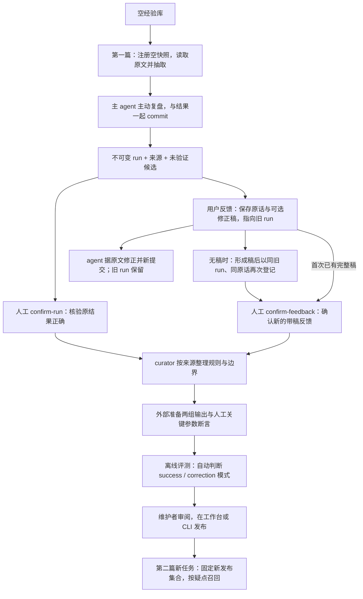
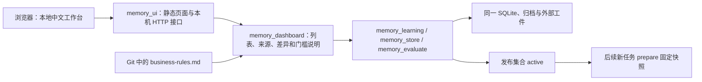

# 经验记忆技术方案与完整数据流

本文对应 **0.4.0**，说明当前实际实现、数据流和人工边界。页面操作见 [本地记忆工作台](memory-dashboard.md)，CLI 参数见 [经验维护说明](../.opencode/skills/term-extract/references/experience.md)，断言格式见 [回归清单](../.opencode/skills/term-extract/references/memory-evaluation.md)。文中编号和目录均为结构示意，仓库不附带案例、私有数据库或运行结果。

当前机制是：主 agent 在正式提交时主动复盘，工具保存不可变运行、用户反馈和候选规则；人工确认来源，离线评测与人工发布后，后续新任务才按需召回规则。模型参数不更新，没有后台监听会话，也不另调模型分析聊天。新会话能用旧经验，是因为工具重新交付持久化规则。

这套流程已有存储和门槛检查，尚无真实效果验证。结构通过、来源确认、离线断言通过与经验发布是不同结论，均不能单独证明全面业务正确或收益提升。

## 1. 从空库到第二篇标书



第一篇不需要已有 badcase，也不需要先建案例库。有新观察就形成候选；没有就提交空 `insights` 并说明原因。候选不参与生产召回，所以保存第一篇不会立即改变第二篇。经验必须经历来源确认、评测和人工发布。

确认运行正确走 `confirm-run`；反馈通路保存的是 `correction` 来源，只有实际不同的完整修正稿才能 `confirm-feedback`。单纯肯定“这篇正确”不能作为纠错确认；curator 可将相关观察整理为引用该 run 的成功经验。

## 2. 分清事实、候选和生效规则

| 内容 | 保存与作用 | 能否直接影响下一篇 |
|---|---|---|
| 固定业务规则 | 技能文件，规定对象、边界、关联、数量等口径 | 开始任务时读取 |
| 运行记录 | 输入/index 绑定、结果、证据、模型与技能信息、经验交付记录 | 不作为历史答案提供给 extractor |
| 复盘 | 本次实际疑点、核验动作或自我修正，附原文标签 | 先形成未验证候选 |
| 用户反馈 | 原话、旧 run 引用、可选 agent 修正稿与复盘 | 尚不是人工正确答案 |
| 人工确认来源 | 已核验成功结果，或已核验反馈修正稿 | 可用于评测，不等于批准规则 |
| 经验修订 | 有触发词、前提、动作、排除情况和来源的不可变规则 | 只有发布版能进入新任务快照 |
| 评测报告 | 给定两组结果满足关键断言及门槛的记录 | 供人工发布判断 |

复盘不能复述既有业务规则或已召回经验，也不应把本篇设备名称、数量、定位标签当成可迁移答案。简短 `observation` 记录实际发生的事实和结论，不保存内部思维链。

### 2.1 编号与规则正文

| 标识 | 含义 |
|---|---|
| `run_id` | 一次不可变生产提交；commit 返回在 `learning.run_id` |
| `feedback_id` | 指向旧 run 的不可变反馈记录 |
| `source_id` | 新来源编号；成功来源等于 run_id，纠错反馈来源等于 feedback_id |
| `correction_id` | 旧版人工导入 input/before/after 的纠错编号 |
| `memory_id + revision` | 一条经验及其不可变修订 |
| `content_sha256` | 规则 payload 的规范 JSON 摘要 |
| `evaluation_id` | 数据库内部不可变评测报告编号 |
| `release_sha256` | 按编号排序后的 `[memory_id, revision, content_sha256]` 发布集合摘要 |
| `snapshot_sha256` | 包含当前 index 绑定信息的任务快照摘要 |

`release_sha256` 不是递增版本号；相同集合可得到相同摘要。来源、候选、确认和评测有各自编号，不能拿 run_id 当经验编号或拿候选编号当发布证明。

规则 payload 示意：

```json
{
  "title": "核对独立清单中的采购量",
  "issue_type": "quantity",
  "triggers": ["采购数量", "purchase quantity"],
  "applies_when": "正文与清单可通过明确采购编号确认是同一计量对象。",
  "rule": "核对编号、单位和适用范围，再将清单数量作为证据。",
  "exclusions": "编号不能对应，或者总计与单站配置的计量对象不同。",
  "correction_ids": [],
  "source_ids": ["run_example"]
}
```

原七字段均必填，仅 `source_ids` 为可选新增字段。`correction_ids` 可为空；自动复盘候选用空 correction_ids 和对应 source_id。单条规范 JSON 最多 4096 字节。`issue_type` 仅有 missing_product、boundary、quantity、association，与最终结果的产品分类不同。程序检查结构与引用，不自动理解自然语言规则的正确性。

## 3. 物理存储与保留要求

使用 Python 标准库 SQLite，无向量库、embedding 或额外服务。默认私有目录为项目 `.term-memory/`；`TERM_EXTRACT_MEMORY_DIR` 可覆盖，配置的相对路径相对于项目根目录。仓库默认忽略 `.term-memory/`，自定义仓库内目录需要自行忽略。

```text
项目根目录/
├── .opencode/skills/term-extract/       # 技能、通用规则和 Python 程序
├── docs/memory-architecture.md         # 本文
├── runs/任务目录/                     # 私有，本次任务资产
│   ├── index.json
│   ├── read_receipts.jsonl
│   ├── memory_snapshot.json
│   ├── memory_receipts.jsonl
│   ├── draft/
│   └── final/result.json、evidence.json、run.json
└── .term-memory/                       # 私有，可外置
    ├── memory.sqlite3                 # WAL 模式，可能有 -wal/-shm
    └── learning-artifacts/<sha>.json   # 内容地址归档
```

空库只读查询不创建数据库；第一次需要写入运行、纠错或候选时创建。备份时应一致地处理 SQLite/WAL 与归档文件，同时保留被引用的原输入、index 和外部评测工件。

### 3.1 十一张表的职责

| 表 | 核心物理列 | 保存内容 |
|---|---|---|
| `learning_runs` | run_id、run_key、record_json、record_sha256 | 不可变运行及归档引用 |
| `learning_feedback` | feedback_id、feedback_key、record_json、record_sha256 | 原话、旧 run、可选修正稿 |
| `learning_sources` | source_id、record_json、record_sha256 | success/correction 类型及来源关联 |
| `learning_confirmations` | source_id、record_json、record_sha256 | 人工确认人、家族、说明与时间 |
| `learning_events` | event_key、record_json、record_sha256 | 复盘、标签证据与自动候选编号 |
| `corrections` | correction_id、record_json、record_sha256 | 旧版已确认纠错 |
| `revisions` | memory_id、revision、payload_json、content_sha256、created_at | 规则修订 |
| `evaluations` | evaluation_id、memory_id、revision、report_json、report_sha256、created_at | 内部评测报告 |
| `active` | memory_id、revision、evaluation_id | 当前发布指针，可更新或删除 |
| `used_evaluations` | evaluation_id | 已发布消耗的报告，防止重用 |
| `audit` | event_id、memory_id、revision、action、record_json、created_at | 发布、撤回审核历史 |

除 active 外均由 SQLite 触发器禁止 UPDATE/DELETE。多数业务字段保存在 JSON 内，**状态不是 revisions 的物理 state 列**；查询时由 active 和该修订最后审核事件推导 candidate/published/superseded/withdrawn。

### 3.2 哪些内容复制，哪些只留引用

- 新运行把结果、证据和 run JSON 保存进数据库记录，并另存规范 JSON 加换行的内容地址文件；run 归档去掉稍后回写的 learning 摘要。反馈修正稿也这样归档。工作目录的最新 final 变化不会覆盖旧归档。
- 原始标书和 index 只保留原路径、SHA 与绑定关系，不自动复制进 learning-artifacts；后续来源读取、确认、评测和发布会核对它们存在且未变。只备份数据库并不足够。
- 旧 import-correction 在 corrections.record_json 内保存解析后的 before_json 和 after_json（分别限制 2 MiB），以及 input/before/after 的路径与哈希。before 无法解析时为 null，保留原文件引用；原输入正文不复制。展示纠错的 CLI/工具省略 before/after 正文，维护者仍可按指定引用复核。
- 评测报告保留外部清单、索引、输出和相关源码/配置的摘要，不把所有评测数据复制进库。

哈希、不可变记录与内容地址归档用于一致性和追溯，不是防本机管理员篡改的签名。确认人和审核人字符串是审计信息，实际权限依赖 agent 配置、操作系统和私有目录访问控制。

## 4. 抽取、主动复盘与用户反馈

### 4.1 注册、读取与正式提交

prepare 解析真实标签输入，生成版本 2 index，并从 active 将全部已发布规则冻结到本任务快照。只向模型返回快照路径、摘要与数量等元数据；磁盘有完整快照不代表模型已经看过全库。

主 agent 完整读取当前原文，保存短候选，按疑点召回并核验。正式提交需要七字段结果、证据 sidecar 与必填 reflection_json，仍检查全文读取覆盖、当前输入版本、标签/关联结构和 unresolved 为空。不满足条件时拒绝提交；没有逐篇人工批准步骤。

reflection 顶层严格含 insights 与 no_experience_reason，每条 insight 严格含六个规则字段加 observation、evidence_tags。最多三条，标签必须来自本篇且不重复；无新经验必须给原因。详见 [字段表](../.opencode/skills/term-extract/references/experience.md)。程序不判断“观察是否真的发生”或规则是否足够新，主 agent 和后续人工承担该判断。

提交成功后登记不可变 run，并返回 learning.run_id。运行身份由 index、结果、证据和 generation（模型、技能、引用规则、经验信息）计算；完全相同的登记可复用同一 run_id，结果或这些身份信息变化会得到新 run。工具不是每次调用都无条件创建不同事件。

结果保存与学习登记分别报告：若 committed=true、learning.status=learning_failed，结果已经保存，但归档或复盘未完成。按 next_action 修复后重试或补齐，不能把这次状态称为经验已保存；演示提交跳过学习登记。工具内部通过临时 JSON 文件向 Python 传递较大的复盘和反馈，避免 Windows 命令行长度限制，对 agent 的 JSON 字符串接口不变。

每条 insight 自动映射成候选 payload：保留六个规则字段，加入 correction_ids=[]、source_ids=[run_id]。observation 与 evidence_tags 留在复盘事件，供来源复核，不随每次经验召回展开。这一步只是保存和建立候选，不代表发现了语义正确的经验。

### 4.2 Pending 与不可变补充

CLI commit/register-run 可以不传复盘，此时运行显示 pending_reflection；OpenCode commit 始终要求复盘。term_memory_reflect 或 CLI reflect 可使用已读原文与结果补齐旧 pending。

同一来源复盘一旦保存，不同内容不能覆盖；同样内容重复调用幂等。补充新事实应保存新反馈，规则优化则创建候选新 revision。来源确认也是不可变记录；不能修改姓名、家族或说明把旧事实换成新事实。

### 4.3 用户反馈与修正稿

term_memory_feedback 接收旧 run_id、用户原话 feedback_text、可选 after_result_json 和必填 reflection_json。原话保留首尾空白，agent 的分析另放复盘。after_result_json 是 agent 整理的完整七字段修正稿，工具只做结构与标签检查；confirm-feedback 前不能称为人工正确答案。

没有足够依据时可以先只保存原话，不强造修正。需要修正最终结果时，先保存指向旧 run 的反馈，再根据原文核验、新提交；旧 run 保留。相同旧 run、原话和修正稿重复登记可复用 feedback_id；该反馈的 source_id 等于 feedback_id，类型 correction。

若第一次未附修正稿，后续形成稿时必须再次登记：同一旧 run_id、同一用户原话，加上完整 after_result_json 和本次复盘。因为修正稿参与反馈身份计算，这会形成新的 feedback_id/source_id；旧的无稿反馈保留未确认。维护者确认新的带稿反馈，curator 以它作为纠错来源整理或修订候选。新结果 commit 不会自动补齐旧反馈，也不会把反馈改为指向新 run。若首次已具备完整稿，可以一次登记。

反馈工具没有自填确认人的参数。只有人工 confirm-feedback 确认了实际不同的完整修正稿，才可用该来源评测；“用户说有错”和“已经人工核验完整修正”是两回事。CLI feedback 可省略复盘，保存明确无经验的空观察；不会像 register-run 一样留下待补复盘。

confirm-run 用于核验旧运行正确并形成成功来源。若同一 run 后续出现已人工确认、实际修改结果的反馈纠错，原 success 来源会被拒绝继续用于评测或发布；记录本身仍保留。它不会自动撤回已 active 的经验，维护者须审阅受影响规则并决定是否 withdraw；新任务仍按 active 建快照，旧任务继续使用旧快照。单纯肯定反馈请走对应 run 的成功确认。

## 5. 从任务快照到有限召回

### 5.1 快照固定什么

memory_snapshot.json 包含 schema_version=1、创建时间、index_sha256、release_sha256、完整已发布 memories 及 snapshot_sha256。每项 memory 保存编号、修订、content_sha256 与完整 payload；不包含来源标书、before/after 或整份评测报告。

快照首次建立后不可覆盖，prepare 拒绝复用已有快照的输出目录，以免重置或混用回执。需要继续任务就沿用原 index；需要切换发布集合就新建目录。撤回不修改旧快照，旧任务可回放旧集合；要立即停止使用旧规则，应停止该任务并重新注册。

### 5.2 当前检索的精确规则

recall 读取当前任务快照，不查询最新 active：

1. 小写英文和数字按 `[a-z0-9][a-z0-9_-]*` 分词，连续中文生成相邻双字集合。
2. 可选 issue_type 做精确过滤。设 query 词集为 Q，triggers 为 T，title + applies_when + rule 为 B，`score = 3 × |Q∩T| + |Q∩B|`。
3. 分数大于 0 可入选；分数降序，同分按 memory_id、revision 稳定排序。不必一定命中 triggers。
4. 先取 top K，再在预算内交付完整条目；放不下就跳过，不截断，也不从 K 以外补位。budget_omitted 统计 top K 内因预算未交付的条目。

exclusions 不参与打分但完整交付；分数不是置信度，程序不执行自然语言前提。默认 top3、6144 字节，OpenCode 可选 limit 1–5、预算 1024–8192 字节；Python 诊断 CLI 预算范围更宽。空库、无匹配或预算不足均可能返回空数组。

主 agent 在当前会话阅读短规则，判断适用性并回原文取证。经验不自动改写结果；检索不调用辅助模型，但工具轮次和规则文本仍占主模型成本。没有疑点不必调用，不按每类设备反复查询。

### 5.3 交付回执与 commit 追溯

OpenCode 适配器先用 defer-receipt 获取结果，核对响应与快照绑定、实际序列化预算，再单独 record-delivery，确认 recorded=true 后返回。只有成功交付的规则记录到 memory_receipts.jsonl。

回执包括时间、schema、snapshot/release/index 摘要和 delivered 列表，每项只有 memory_id、revision、content_sha256。空召回可记录空列表；不保存 query、分数、全文或“已采用”结论。

commit 重新校验快照自身摘要、index 绑定和所有回执身份；缺失/损坏快照或回执不合法会拒绝提交。程序把实际交付条目按编号聚合去重写入 run.json.memory，七字段 result.json 保持不变。

这些记录能回答“哪版规则被工具交付”，不能证明模型采用了哪条、采用是否正确，也不是足以逐字复现输出的完整模型请求记录。

## 6. 来源确认、候选维护与评测

### 6.1 人工确认与 curator 的分工

维护者先用 list/show-run/show-source 查看运行与反馈，再通过 confirm-run 或 confirm-feedback 指定 confirmed_by、family_id、note。所有 source_ids 必须确认后才可评测和发布；旧 correction_ids 的人工导入记录兼容原通路。

curator 可以读取指定来源及复盘证据，用 propose 整理最小规则和适用边界，或沿同一 memory_id 创建新修订；propose 可以先引用未确认来源，但不能跳过后续确认。新候选不修改 active，也不覆盖发布版。合并来源时必须保留真实依据，不能用无来源候选绕过审查。

family_id 是人为分组：译文、修订版和近重复模板属于同一家族。程序能检查显式家族与相同输入 SHA，不能自动认识所有近重复材料。最终 holdout 不得参与本轮归纳和发布调参。

### 6.2 两组输出从哪里来

用户或外部实验流程准备 baseline、candidate 和人工关键参数断言 manifest。候选未发布，生产 recall 不会返回它；实验须在隔离上下文明确提供候选，不能为了试验先发布。

评测器不调用抽取模型，不生成两组输出，不认证候选实际被注入。人工正确答案不能冒充 candidate 模型输出。当前没有自动批量运行、冻结全部推理参数并核验生成来源的实验运行器；需额外保留可比较配置和运行来源。源码哈希只是评测时读到的版本，不能证明生成结果时用了该版本。

### 6.3 success 与 correction 自动分流

模式由全部已确认来源推导，不在 manifest 手填：

| 模式 | 来源 | 开发目标 |
|---|---|---|
| `success` | 仅成功来源 | 至少一个 role=success、split=development，家族与输入匹配来源；baseline 解析七字段 JSON 等于该来源已确认归档结果，两组断言均全通过 |
| `correction` | 包含任意纠错，包括新反馈、旧 correction 或混合来源 | 至少一个 role=fix、split=development，从 baseline 有断言失败变为 candidate 全通过 |

success baseline 的解析值比较忽略文件排版，报告记录 success_source_id 和 success_result_sha256。candidate 可以在合法结构与断言约束下不同于原结果。此绑定保护已确认基线不被另造，但不认证 candidate 的模型生成来源或因果收益。

任意 success 目标 baseline 不过会使报告失败；所有 fix/success 目标 candidate 不过均计入 unfixed_target_cases。成功路径不需要制造 badcase，只证明在已确认开发案例上保持一致，并保护清单列出的旧正确条件。

### 6.4 人工断言怎样判断采购对象

anchor_tag 必须位于唯一 normal/separate 记录自身范围；零匹配是漏对象，多匹配是歧义。object_key 仅用于报告显示，标题与产品分类不用于对象匹配。

有效参数范围是：主体自身 + separate 关联的 normal/separate 连通分量 + 直接指向这些成员的 general。不会沿 general 扩散到它约束的另一设备。程序不能自动证明 separate 业务身份正确，需 forbidden_tags 等边界断言保护。

| 断言 | 实际检查 | 局限 |
|---|---|---|
| required_tags | 有效参数范围覆盖标签 | 不认识未标注的重要参数 |
| forbidden_tags | 范围不包含标签 | 不自动识别标签内部混合参数 |
| quantity | anchor 主体数量字符串精确相等 | 不做数值/单位归一化或所有 separate 一致性验收 |
| clause_category | anchor 主体分类精确相等 | 不验收全文所有 general/separate 语义 |

顺序按 index 原文 order，不按标签数字。允许未被禁止的无害冗余，不要求边界与金标准完全一致；general 不单独作为 anchor 主体。两组结果先做结构校验，error 失败；这里不要求 evidence，warnings 本身不失败。

### 6.5 硬门槛、独立性与报告绑定

| 门槛 | 要求 |
|---|---|
| 模式目标 | correction 的 fix_improvements ≥ 1；success 的 success_cases ≥ 1 |
| unfixed_target_cases | 0；success baseline 失败也硬拒绝 |
| regressions | 0，按 baseline 已通过而 candidate 失败的断言计数 |
| independent_regression_cases | ≥ 1；非开发目标，独立于全部来源，两组均全通过 |
| counterexample_cases | ≥ 1；同样独立、两组全通过，另有不适用说明与边界断言 |

独立性要求家族不同且输入 SHA 不同，针对该候选引用的全部来源，不自动与全历史库隔离。同一合格反例可兼作独立回归，所以最小清单可由一个开发目标和一个独立反例组成；覆盖范围仍应随规则影响扩大。

无退化只针对清单中 baseline 已通过的断言。非目标中 baseline/candidate 都失败的条件不会单独算退化，其他门槛够时仍可能通过；不能说“所有回归案例都正确”或“未标注参数无退化”。

报告绑定候选内容、当前 release、source_ids 对应的确认摘要 source_confirmations、全部来源身份、manifest/index/输出、来源不可变归档和相关代码/配置。旧 correction_ids 沿用人工导入记录。来源与工件在入库和发布时重核。独立评测案例原输入缺失时可按保留 index 检查，并记 original_source_verified=false；学习来源本身的原输入、index、归档与旧纠错原文件仍须有效。

## 7. 发布、修订和撤回

publish 由维护者在本地工作台或 CLI 执行。事务核对候选、数据库内部评测报告、当前 release、所有来源确认和外部工件；报告须通过且未使用。通过后追加 audit、记录 used_evaluations 并切换 active。报告绑定的集合或文件变化就要重新评测，不允许复用外部伪造报告绕过内部记录。

| 动作 | 内容与当前发布状态 | 新任务 |
|---|---|---|
| 创建 v1 候选 | 增加修订，无 active | 看不到 |
| 发布 v1 | 内容不变，active 指向 v1 | 固定 v1 |
| 创建 v2 候选 | 保留两版，active 仍为 v1 | 仍固定 v1 |
| 发布 v2 | active 改为 v2，v1 为 superseded | 固定 v2 |
| 撤回 | 删除 active，保留内容和审核事件 | 不再固定该经验 |

list 的 state 描述最新修订，active_revision 描述当前发布版，因此最新 v2=candidate、active_revision=1 可以同时成立。撤回不自动恢复旧版；重新启用须针对当前集合重新评测发布，旧评测编号即使撤回后也不能重复使用。旧任务快照始终保留。

## 8. 工具权限与人工边界

| 动作 | extractor | curator | 维护者工作台 / CLI |
|---|---|---|---|
| 按任务快照 recall | 允许 | 未开放 | 可诊断 |
| feedback / reflect | 两者允许 | 仅 reflect | 允许 |
| 读指定 source/correction/revision | 不允许 | 允许 | 允许 |
| propose / evaluate | 不允许 | 允许 | 允许 |
| import-correction / confirm-run / confirm-feedback | 不允许 | 不允许 | 允许 |
| publish / withdraw | 不允许 | 不允许 | 允许 |

两类 agent 都禁 shell、编辑与委派，extractor 普通文件读取另限技能资料和当前候选；不会通过私有数据库或历史 final 找本篇答案。权限阻止在正常 agent 流程自填确认人，但不替代本机账号和文件权限。

人工负责确认案例、断言/家族划分和规则适用边界三个判断。可以由同一维护者承担，不要求重复核验同一事实；成功确认不能替代泛化审阅，评测通过也不能自动批准发布。

## 9. 当前实现与剩余限制

| 能力 | 状态与边界 |
|---|---|
| 不可变运行、主动复盘、原话反馈、来源确认 | 已实现；反思由 agent 显式调用触发，无后台监听 |
| 来源关联候选、修订、有限召回、快照、回执 | 已实现；候选隔离，交付不等于采用 |
| success/correction 离线门槛、人工发布与撤回 | 已实现；只针对提供的工件和断言 |
| 自动生成两组输出与核验完整推理配置 | 未实现，依赖外部实验流程 |
| 自动判断全面业务正确、经验因果收益 | 未实现，当前尚无真实效果验证 |
| 向量/跨语言语义召回、规则冲突自动检测 | 未实现，当前为词语排序与主 agent 判断 |
| 按模型隔离经验、跨模型效果保证 | 未实现；同库共用发布集合，可人为外置不同库 |
| 本地可视化工作台 | 已实现；读取同一私有库，可确认、修订、评测、发布和撤回 |
| 多用户认证 | 未实现；仅监听本机，审核姓名是审计信息 |

### 9.1 工作台的数据流



工作台无需 OpenCode 会话或额外模型调用。浏览查询不会创建空数据库；编辑规则创建新修订，完善反馈创建新的带稿反馈，不覆盖旧记录。读取正文和列出门槛只是辅助维护者判断；确认、评测、发布继续调用原有实现，不把按钮点击当成业务正确证明。

页面显示的是数据库中的真实状态。固定业务口径从技能文件读取，差异来自本地 Git 历史，不伪装成已发布经验。历史运行的口径摘要与当前文件不同只提示版本变化，不自动判断其结果错误，也不会重新计算旧快照。详情与操作步骤见 [工作台说明](memory-dashboard.md)。

## 10. 代码阅读索引

| 代码 | 关注点 |
|---|---|
| [memory_learning.py](../.opencode/skills/term-extract/scripts/memory_learning.py) | register_run、validate_reflection、record_feedback、来源与人工确认 |
| [memory_store.py](../.opencode/skills/term-extract/scripts/memory_store.py) | 表结构、修订/发布、create_snapshot、recall、run_memory_record |
| [memory_evaluate.py](../.opencode/skills/term-extract/scripts/memory_evaluate.py) | 来源推导、success 基线绑定、断言、门槛与工件哈希 |
| [memory_dashboard.py](../.opencode/skills/term-extract/scripts/memory_dashboard.py) | 只读汇总、来源与差异、门槛说明、复用原维护动作 |
| [memory_ui.py](../.opencode/skills/term-extract/scripts/memory_ui.py) | 本机 HTTP 服务、静态页面、请求校验与只读模式 |
| [web/memory](../web/memory/) | 中文工作台界面，无额外前端依赖 |
| [term_memory.ts](../.opencode/tools/term_memory.ts) | 召回预算与回执、feedback/source/reflect、维护工具 |
| [term_result.ts](../.opencode/tools/term_result.ts) | 必填 reflection_json 与正式提交入口 |
| [term_document.ts](../.opencode/tools/term_document.ts) | 注册时固定快照，拒绝覆盖旧任务 |
| [commit_result.py](../.opencode/skills/term-extract/scripts/commit_result.py) | 读取覆盖、快照、结果及学习登记 |
| [term-extractor.md](../.opencode/agents/term-extractor.md) | 抽取与主动复盘职责 |
| [term-memory-curator.md](../.opencode/agents/term-memory-curator.md) | 来源整理、候选与离线评测权限 |
