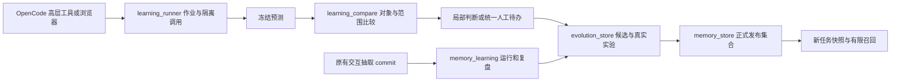

# 经验记忆架构（0.5.0）

从第一篇标书产生经验、两种模式、自动验证和人工入口，详见[抽取与经验演进方案](learning-evolution.md)。本文侧重数据、版本和旧维护入口；网页操作见[工作台说明](memory-dashboard.md)。

## 1. 三层知识与三类依据

| 层 | 存储位置 | 如何使用 |
|---|---|---|
| 固定业务口径 | Git 中的 `references/business-rules.md` | 每次抽取明确交付；业务范围变更需显式修改 |
| 可迁移经验 | SQLite 中的不可变修订和正式发布指针 | 按任务快照召回少量适用规则 |
| 原始案例和实验 | 私有输入/标签归档、运行和事件工件 | 支持复核、比较和晋级，不把历史答案直接交给生产抽取 |

纯抽取产生的是原文支持的观察；用户输入与正确结果构成可信标签案例；模型或人工对局部差异的答复只解决该事项。三者不能互相冒充，局部确认也不等于整篇验收。

## 2. 主要数据流



高层运行器使用临时项目、新会话、禁止工具的 OpenCode 工作器完成抽取。程序在导入阶段校验可信标签结构，但盲抽模型不接收标签；预测冻结后才进入标签比较和复盘。

正式 baseline/candidate 输出由模型实际生成，提示、原始事件、会话和结果绑定存档。报告注册重新计算比较并核对工件，不把外部填写的通过标志当成实验结果。

## 3. 私有目录

默认目录为 `.term-memory/`，可通过 `TERM_EXTRACT_MEMORY_DIR` 外置。页面和 OpenCode 必须使用同一个目录。

```text
.term-memory/
├─ memory.sqlite3
├─ learning-artifacts/      原有运行、证据和反馈的内容地址归档
├─ evolution-artifacts/     可信案例输入、标签及内部索引
└─ .workflow/jobs/          高层作业提示、预测、事件、比较和实验缓存

runs/                       原有交互抽取的索引、回执和结果
```

私有目录和真实文档不随代码推送。可信案例同时绑定原文件和归档，旧来源也绑定原输入/index；这些文件是后续核验的一部分，不能只保留数据库后删除所有外部依据。

## 4. 数据表与不可变性

原有表继续保存：

- `revisions`：完整候选 payload、修订和内容摘要。
- `active`：当前发布版本及其评测；它是可变化的发布指针。
- `evaluations`、`used_evaluations`、`audit`：报告、使用状态和审计。
- `learning_runs`、`learning_feedback`、`learning_sources`、`learning_confirmations`、`learning_events`：不可变来源、复盘和旧人工确认。
- `corrections`：兼容旧人工纠错导入。

0.5.0 新增：

| 表 | 内容 |
|---|---|
| `workflow_jobs` / `workflow_job_events` | 任务身份、阶段、调用、检查点和下一步 |
| `workflow_settings` | 追加保存的模型与预算设置 |
| `workflow_claims` | 后台执行占用，防止同一任务重复并发 |
| `evoz_cases` | 用户声明的可信标签案例、案例族、用途及工件摘要 |
| `evoz_reviews` / `evoz_resolutions` | 同一套网页与对话待办、局部答复 |
| `evoz_decisions` | 候选不采纳、合并或待复核等维护结论 |
| `evoz_origins` | 候选由何次观察、标签复盘及证据产生 |
| `evoz_conflicts` | 疑似冲突、口径版本和对应待办 |
| `evoz_scans` | 扫描签名、完成时间和七天维护周期依据 |
| `evoz_experiments` | 完整配对实验、重新计算的比较和晋级报告 |

事实与修订表通过 SQLite 触发器阻止 UPDATE/DELETE；新事实追加记录，修改规则创建新 revision。任务当前状态从事件重建。发布指针和执行占用是有意可变化的状态，不能把全库描述为完全不可变。

哈希用于一致性和复放，审核人字符串用于审计。这不是多用户身份认证，也不是抵抗管理员篡改的签名。服务只监听本机，写请求检查来源与令牌；权限仍依赖本机账号和目录访问控制。

## 5. 规则、快照和召回

规则 payload 保留 `title`、`issue_type`、`triggers`、`applies_when`、`rule`、`exclusions`、`correction_ids`，可带 `source_ids`。观察事实和证据标签单独留在来源记录，不随每次召回展开。单条规则规范 JSON 上限为 4096 字节。

任务注册固定 `memory_snapshot.json`，绑定当前 index 和发布集合。快照保存规则内容和版本，不保存历史标书全文。新任务才能使用后续发布或撤回的集合；旧任务可按旧快照复放。

召回为关键词匹配，使用有限繁简和中英别名、英文词项与中文双字词。触发词交集权重为 3，规则正文词项交集权重为 1；只选择得分大于零的条目，稳定排序并在预算内交付完整规则。默认交互工具最多三条、6144 字节，高层运行器使用最多五条、8192 字节。

交付清单说明模型收到哪些版本，不说明它是否采用、采用是否正确。没有向量模型、语义数据库或每篇先建全文向量索引。

## 6. 自动验证与生效

可信标签不要求再执行旧版的逐来源人工确认。系统比较完整采购对象、有效参数范围、general/separate 关系和数量；产品分类不计分，区间不同先做局部语义判断。

自动实验绑定候选全部来源，至少检查学习目标、独立回归和独立反例，回归与反例来自两个独立案例族。候选必须达到正确且无已检查指标退化，工件、业务口径和当前发布集合一致，并处理阻塞冲突。开启自动发布后，由内部实验报告更新正式指针。

`success_cases` 包括保持原本正确，不等于证明准确率改善；只有 `fix_improvements` 记录本实验中的修复改善。真实长期收益仍需独立标注案例和实际成本数据验证。

撤回保留规则、实验和审计，不自动恢复旧版，也不改已有快照。重新发布需针对当前集合重新验证，不能重复使用已经消费的报告。生产快照保持创建时版本，每项候选实验另固定启动时的正式集合；前一候选发布后，后续候选建立新的实验基线，分别留痕。实验中集合再变化时保留工件并重试，不改写原始预测。

## 7. 旧手动维护入口继续兼容

原有交互式提交仍强制带 `reflection_json`，保存 run、证据和未验证候选。反馈保存用户原话及可选完整修正稿；agent 整理稿在旧手动来源确认前不能称为人工正确标签。

旧流程仍可执行：

```text
交互抽取并复盘 → 人工确认成功 run 或带稿 feedback
    → curator 整理候选 → 提供两组输出和人工断言 manifest
    → memory_evaluate 离线检查 → 人工发布或撤回
```

它只检查提供的工件和断言，不自动生成实验输出；0.5.0 高层任务的真实模型实验是另一条显式入口。旧路径与新路径共用修订、发布、快照和审计，不能通过切换入口降低各自证据门槛。

详细 CLI、反射字段与旧反馈补全方式见[经验维护说明](../.opencode/skills/term-extract/references/experience.md)，旧人工断言格式见[离线回归清单](../.opencode/skills/term-extract/references/memory-evaluation.md)。

## 8. 当前边界

- 来源可靠性以用户提供标签的声明为前提；结构检查不会发现所有标签语义错误。
- 范围比较保守，局部上下文有预算；截断或语义歧义可能需要人工。
- 家族近重复、反例适用性和模型判断仍不可能由哈希完全证明。
- 关键词及冲突检查是有限规则，不是完整语义理解；可写网页服务的后台维护默认七天重扫，服务关闭期间不执行，也可由人工强制触发。
- 工作器完整交付原文；超出配置和模型窗口时停止，不自动完成复杂分块规划。
- 记录实际模型调用及服务返回用量，不保证所有 provider 返回 token 和费用。
- 合成测试通过代表实现边界受检查，尚不能据此认定真实业务准确率和成本收益。

## 9. 代码阅读顺序

先读 `learning_runner.py` 的 `create_job / run_job`，再看 `learning_compare.py` 的对象分组和差异，随后看 `evolution_store.py` 的案例、待办与内部实验注册。底层版本和召回在 `memory_store.py`，词法归一化在 `memory_lexical.py`。

网页通过 `memory_ui.py → memory_dashboard.py / evolution_dashboard.py` 调用同一套服务；`term_learning.ts → evolution_cli.py` 是 OpenCode 对应入口。旧来源、复盘和断言评测分别在 `memory_learning.py`、`commit_result.py`、`memory_evaluate.py`。
